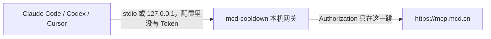

# mcd-cooldown

**额度还没回来。饭先核好价。下单键在你手里。**

Claude Code、Codex 或 Cursor 的额度见底，或者写到了午饭晚饭，状态栏会提你起来吃，并带上已经核好的价。本地 MCP 网关把 Token 留在本机，下单、抽奖和积分兑换默认只核价，你在终端确认后才放行。不弹窗，也没有常驻进程。换客户端也一样。

非麦当劳官方产品。价格和供应以麦当劳官方实时结果为准。输出不是营养或医疗建议。


```text
┌─ mcd-cooldown ────────────────────────────────────────────┐
│ 5h 额度 96% · 约 41 分钟后恢复                            │
│ 建议 21:41 前确认。到店自取，起身活动一下。现在只是核价。 │
│ 核价 ¥36.50 · 常点一份 · 只核价，未下单                   │
│ 确认 mcd-cooldown confirm 7f3a2c1b                        │
│ 网关已拦住写操作 · Token 不进模型                         │
└───────────────────────────────────────────────────────────┘
非麦当劳官方产品 · 默认只核价 · 确认后才下单
```

## 30 秒看懂

```bash
git clone https://github.com/Adonis0123/mcd-cooldown.git && cd mcd-cooldown && npm install && node dist/src/cli.js demo && node dist/src/cli.js doctor --mock
```

`demo` 是离线预览。`doctor --mock` 走样例服务，只做只读调用，不会下单。样例门店和价格不是官方实时数据。

有 Token 之后，把下面这一行留在本机终端，不要写进仓库：

```bash
export MCD_MCP_TOKEN="从 open.mcd.cn 复制的 Token" && node dist/src/cli.js doctor
```

`doctor` 会检查 Token 是否泄漏到项目文件，然后连接 `https://mcp.mcd.cn`，列出工具，并只读查询当前时间、活动日历和营养数据长度。它不查订单、不领券、不抽奖、不下单。

想顺手看附近门店时再加参数，例如 `--city 上海 --keyword 南京西路`。返回的 `storeCode` 和 `beCode` 可以抄进本机配置。

## 它做什么



一层是 **mcd-guard**。它站在任意 MCP 客户端和麦当劳 MCP 之间。Token 放在环境变量或 `~/.mcd-cooldown/token`，不进模型上下文。`create-order`、`cancel-order`、`auto-bind-coupons`、`draw-lottery`、`mall-create-order`、`delivery-create-address`、`party-order-create` 会在协议层被拦住。模型就算重试，也只是再拿到一次「未提交」。

另一层是 **cooldown**。Claude Code 把额度窗口从状态栏标准输入送进来。接近用尽时，按 `resets_at` 倒推一个确认时间，并用你保存的常点餐品调用 `calculate-price`。到店自取是默认场景，起来走一趟也当作休息。确认之前没有任何订单。

午饭和晚饭也走这一条状态栏。你配置的是想几点吃上，默认工作日 12:00 和 18:30。提醒时刻用出餐或配送时间往前倒：`calculate-price` 里若有预计分钟就用它，没有就用默认 20 分钟。状态栏写成「现在确认，约 12:05 可取」。外送则是「现在确认，约 12:05 送达」。每顿每天的 Stop hook 最多说一次。已吃或带了饭、稍后 15 分钟、今天跳过，各是一条命令。已经确认过的那顿，或者过了饭点 45 分钟，提醒自己消失。额度快用完又刚好是饭点时，合成一条，不说两遍。

```text
mcd · 午饭时间 · 起来吃一点 · 现在确认，约 12:05 可取 · 已核价 ¥36.50 · 确认 7f3a2c1b
```

赶上额度窗口时：

```text
mcd · 午饭时间 · 现在确认，约 12:05 可取 · 已核价 ¥36.50 · 确认 7f3a2c1b · 5h 96% · 41 分钟后恢复
```

写到比较晚（默认北京时间 23:00 到次日 06:00）时，状态栏会先说「夜深了，先休息」。饭点提醒让路。核价可以留着，这个时段真要提交必须加上 `--allow-quiet`。份量按你自己保存的那一份，不额外加购。时间按配置里的时区计算，默认北京时间。

网关拦住的是 MCP 工具调用。如果你的客户端还能执行本机命令，请不要让它自动运行 `confirm`。金额上限和休息时段开关仍然有效，但挡不住一个被允许执行任意命令的代理。

## 接到 Claude Code

状态栏会频繁执行，请指向本机文件，不要每次都走 `npx`。

```json
{
  "statusLine": {
    "type": "command",
    "command": "node /ABSOLUTE/PATH/mcd-cooldown/dist/src/cli.js statusline"
  },
  "hooks": {
    "Stop": [
      {
        "hooks": [
          {
            "type": "command",
            "command": "node /ABSOLUTE/PATH/mcd-cooldown/dist/src/cli.js hook"
          }
        ]
      }
    ]
  }
}
```

完整片段在 `examples/claude-settings.json`。Codex 或其他终端没有同一份状态栏 JSON 时，可以把同一条 `statusline` 命令放进你自己的 prompt，或者在额度用尽时调用 `hook`。这是可选项，网关本身不依赖某一个客户端。

客户端 MCP 配置只指向本地网关。可复制的占位示例是仓库根目录的 `mcp-config.example.json`：

```json
{
  "mcpServers": {
    "mcd-cooldown": {
      "command": "node",
      "args": ["/ABSOLUTE/PATH/mcd-cooldown/dist/src/cli.js", "guard"],
      "env": {
        "MCD_MCP_TOKEN": "${MCD_MCP_TOKEN}",
        "MCD_MCP_URL": "https://mcp.mcd.cn"
      }
    }
  }
}
```

`${MCD_MCP_TOKEN}` 由你的 shell 提供。不要把真实 Token 写进这个 JSON。

本机准备常点餐品：

```bash
node dist/src/cli.js init
node dist/src/cli.js meals on
```

`init` 在交互终端里会问要不要打开饭点提醒。非交互环境直接执行 `meals on`。改时间：

```bash
node dist/src/cli.js meals lunch 12:15
node dist/src/cli.js meals dinner 19:00
node dist/src/cli.js ate
node dist/src/cli.js later
node dist/src/cli.js skip
```

`ate` 表示这顿已经吃了或带了饭，`later` 是 15 分钟后再说，`skip` 是今天这顿跳过。周末默认关闭，`meals weekends on` 才连周末一起看。系统通知默认关闭；`meals notify on` 之后，也只在那一次 Stop hook 里尝试发送。

编辑 `~/.mcd-cooldown/config.json`，把 `YOUR_` 开头的占位换成你自己的门店和餐品编码。然后：

```bash
node dist/src/cli.js plan
node dist/src/cli.js confirm <请求号>
node dist/src/cli.js watch <订单号>
```

`confirm` 会再核一次价。超限、读不到金额，或请求过期，都不会下单。支付链接需要你自己打开，程序不代付。

## 命令

| 命令 | 作用 |
|---|---|
| `doctor` | 只读自检。没有 Token 时加 `--mock` |
| `guard` | 标准输入输出上的 MCP 网关 |
| `serve` | 只监听 `127.0.0.1:39217` 的 HTTP 网关 |
| `plan` | 按额度恢复时间核价，不下单 |
| `statusline` | 打印一行状态。不联网 |
| `hook` | 在额度偏高、饭点、连续写作或休息时段提醒，并可准备核价 |
| `meals` | 开关饭点提醒，或改午饭、晚饭、周末 |
| `ate` / `later` / `skip` | 这顿已吃、15 分钟后再说、今天跳过 |
| `confirm` / `deny` | 本机放行或拒绝一笔被拦住的操作 |
| `pending` / `log` | 查看待确认请求和脱敏后的调用记录 |
| `watch` | 查询订单状态并留给状态栏 |
| `mock` | 本机样例 MCP，不是官方实时数据 |
| `demo` | 离线终端预览 |

默认单笔 80 元，当日 150 元，单笔最多 12 份。可在配置或 `MCD_MAX_ORDER_CNY`、`MCD_DAILY_LIMIT_CNY`、`MCD_MAX_ITEM_QUANTITY` 里改。主题活动下单没有餐饮核价，仍然必须确认，并计入每日非餐饮写操作次数。

## 测试

```bash
npm test
```

测试使用合成样例，不连接官方服务，也不包含真实 Token、订单或地址。配置 Token 之后，用 `doctor` 做一次真实只读验证。

## 参赛文件

仓库根目录包含 `README.md`、原样复制的 `CONTEST_DECLARATION.md`、`MCP_INTEGRATION.md` 和 `mcp-config.example.json`。可直接粘贴的报名正文在 `docs/contest-issue.md`。建议 Issue 标题：`【参赛申请】mcd-cooldown：额度用完，先核价`。

## 许可

MIT。麦当劳名称用于说明所接入的官方 MCP 服务。本项目与麦当劳没有隶属关系，也不构成官方背书。
